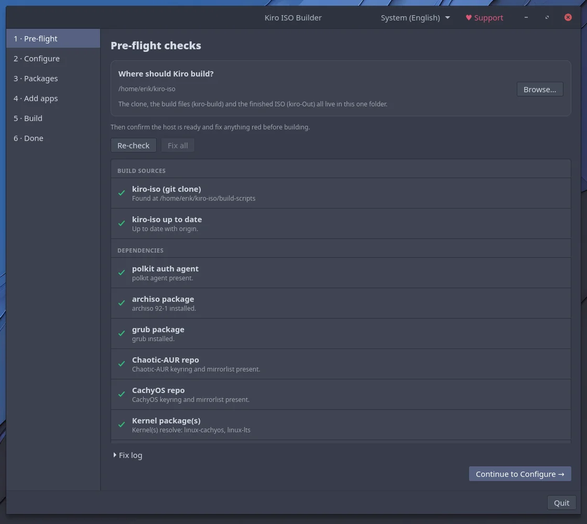
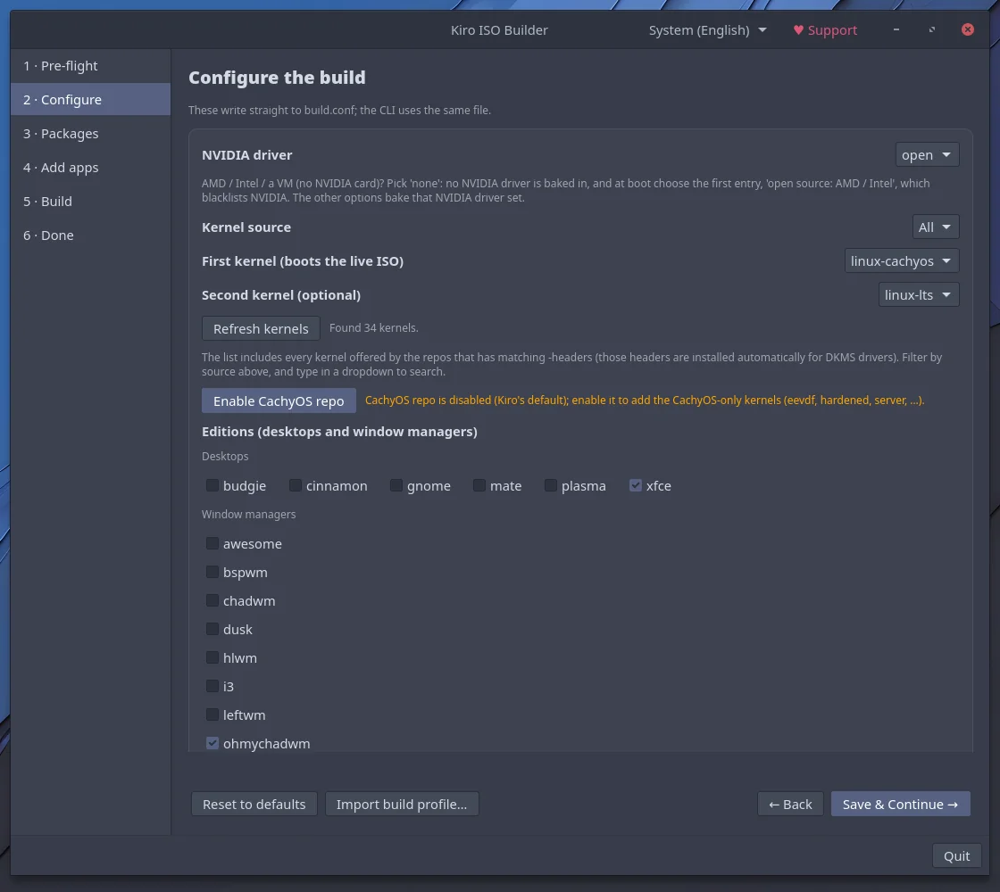
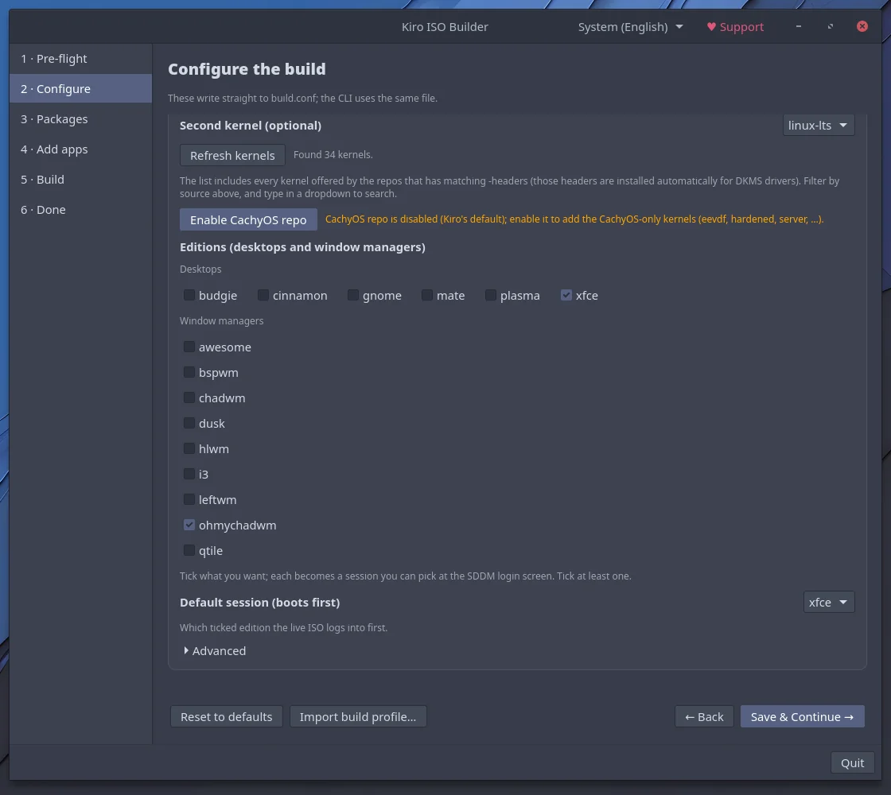
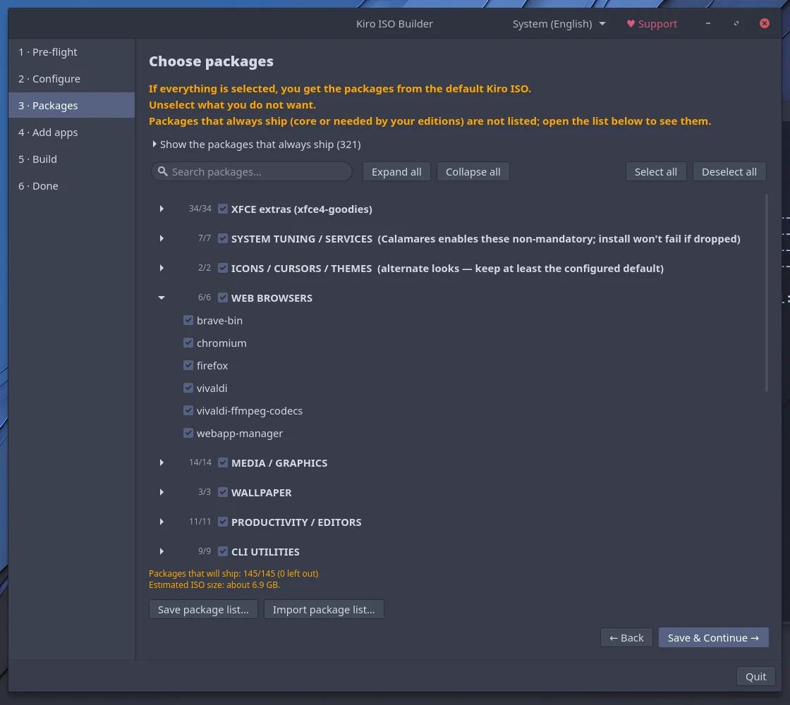
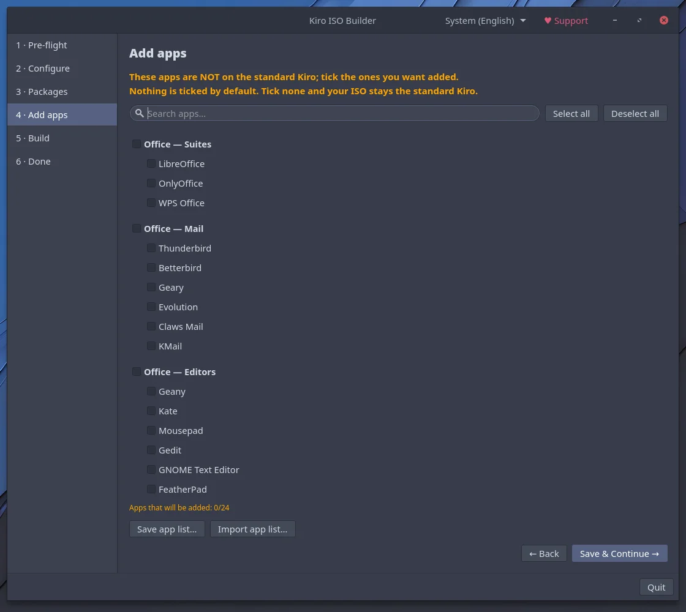
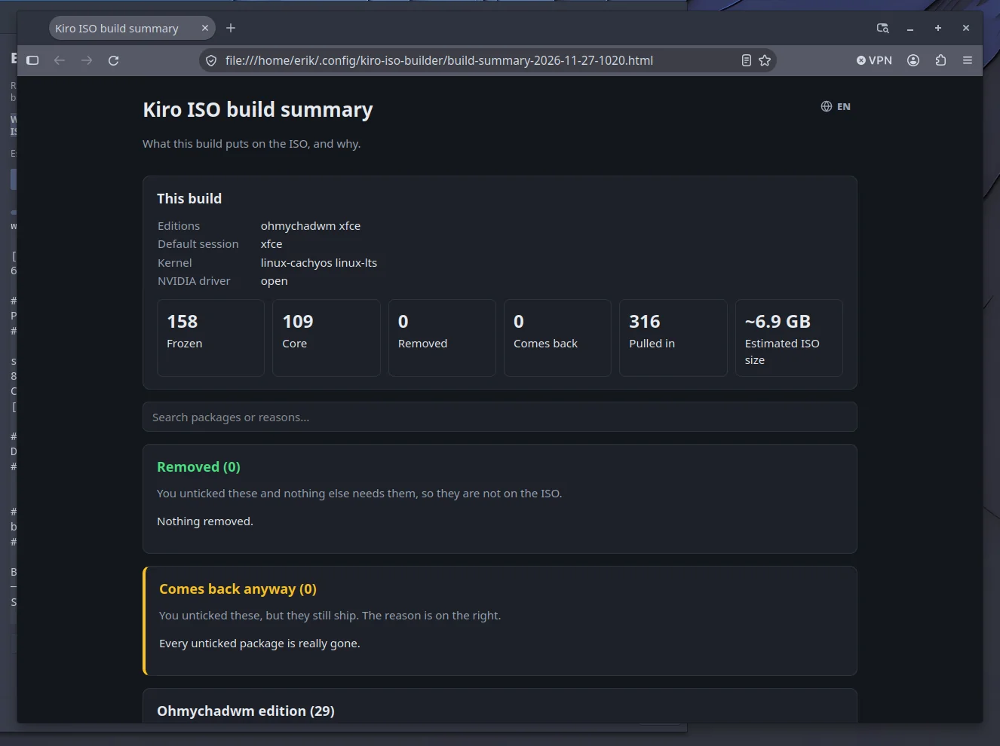
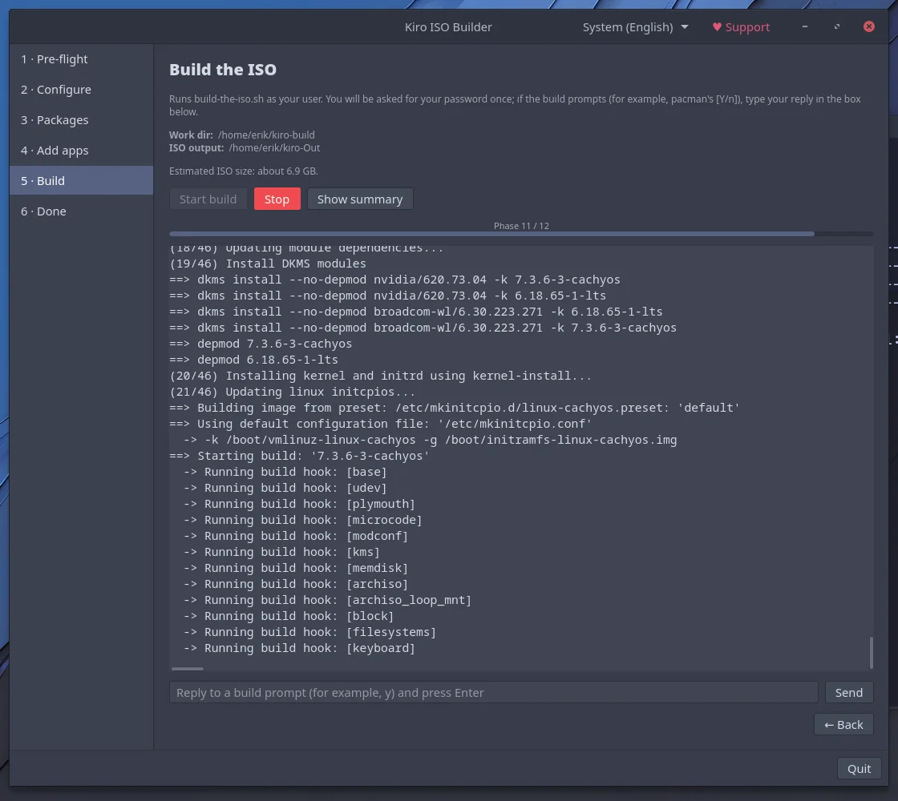
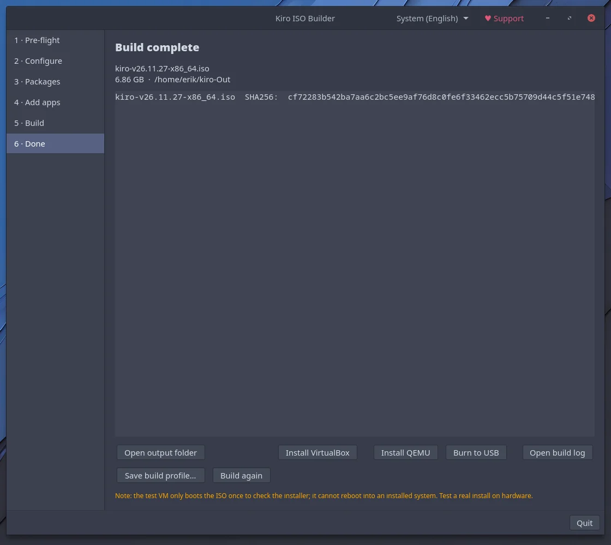

# Kiro ISO Builder
 
A GTK4 front-end that makes building the Kiro ISO clickable — and **corrects bad
host settings before the build** instead of letting `mkarchiso` fail halfway. It is a
front-end, not a reimplementation: the build pipeline stays in
[`kiro-iso/build-scripts`](https://github.com/kirodubes/kiro-iso); this app drives it.

Works on any Arch-based host (Arch, CachyOS, EndeavourOS, Garuda, …).

## How it runs

- Launches as your **normal user** — never as root.
- Pre-flight **fixes** are elevated on demand with `pkexec` (one polkit prompt each),
  reusing `host-prep.sh`'s idempotent functions, so a GUI-fixed host is identical to a
  CLI-prepared one.
- The **build** runs `build-the-iso.sh` as you (it refuses root and `sudo`s internally).
  It runs inside a PTY, so its one `sudo` password prompt appears as a dialog and is then
  cached for the whole run.

## Screens

1. **Pre-flight** — checks the host (repo present, Arch-based, polkit agent, `archiso`/`grub`,
   Chaotic + CachyOS repos, disk space, kernel tokens, NVIDIA choice) and offers one-click fixes.
2. **Configure** — `nvidia_driver`, `kernel` (two dropdowns + a **Detect** button that lists
   the host's real kernels — only those with matching `-headers`), `bump_version` and a few
   advanced knobs, written straight to `build.conf`. Headers install automatically per kernel.
3. **Build** — the estimated ISO size (also under the Packages list, with what your unticks save), then the live log + phase progress (auto-derived from the build script), stoppable. **Show summary** opens a browser page listing what the build removes, keeps (and why) and pulls in.
4. **Done** — open `~/kiro-Out`, show checksums, boot the ISO in QEMU.

## Screenshots

Kiro ISO Builder 26.11 building the standard Kiro ISO (XFCE + Ohmychadwm, linux-cachyos + linux-lts).

<table>
<tr><td align="center"><br><sub>Pre-flight: every check green, one-click fixes</sub></td><td align="center"><br><sub>Configure: NVIDIA driver and kernels</sub></td></tr>
<tr><td align="center"><br><sub>Configure: editions and the default session</sub></td><td align="center"><br><sub>Packages: grouped, with the estimated ISO size</sub></td></tr>
<tr><td align="center"><br><sub>Add apps: opt-in apps that are not on the standard ISO</sub></td><td align="center"><br><sub>Build summary: what goes on the ISO and why</sub></td></tr>
<tr><td align="center"><br><sub>Build: live log and phase progress</sub></td><td align="center"><br><sub>Done: the ISO and its SHA256</sub></td></tr>
</table>

## Run from source

```bash
python3 kiro-iso-builder.py
```

The app finds the `kiro-iso` repo automatically when it sits beside this one, at
`~/kiro-iso`, or `/usr/share/kiro-iso`. Override with `KIRO_ISO_DIR=/path/to/kiro-iso`.
If it isn't found, the Pre-flight screen can clone it.

## Tests

`bash tests/run-tests.sh` runs the unit tests, a contract test against `build-the-iso.sh`, ruff and a GUI
smoke test (when a desktop session is available).

## Languages

The interface is available in English, Dutch, German, Spanish, French, Brazilian Portuguese, Russian, Hungarian,
Italian, Turkish, Polish, Japanese, Simplified Chinese and Romanian. It follows the system language by default.
Pick another language from the dropdown in the header and click **Restart now**; the choice is saved for later
launches. Build logs, `build.conf` and the build-summary page stay in English.

The gettext catalogs live in `po/`. After changing English UI text, run `bash po/make-mo.sh` to refresh the
template, compile the catalogs into `locale/` and regenerate the menu entry.

## Requirements

`python-gobject`, `gtk4`, `polkit` (+ a polkit auth agent for your session), `pacman`,
and for the optional VM test, `qemu`.
